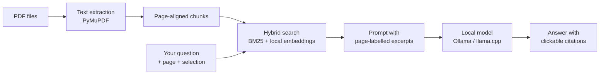

# pagelight

**Ask your PDFs anything, completely offline.**


---

pagelight is a PDF reader with a local language model built in. You open a PDF (or a whole folder of them) from the terminal, it shows up in your browser, and there's a chat panel next to the page. You can ask about the page you're on, a passage you've selected, or anything else in your PDFs. Answers cite the pages they came from, and clicking a citation takes you to that page.

Most chat-with-your-PDF tools upload your file to a server somewhere. That's a problem if the PDF is a contract, a medical record, an unpublished paper, or anything else you'd like to keep private. pagelight runs everything on your own machine: the rendering, the search and the model. Once you've downloaded a model, you can turn off Wi-Fi and it still works.

- Your documents stay on your computer. There are no accounts or API keys, and pagelight won't connect to a model server that isn't local (see [Privacy](#privacy)).
- The only runtime dependency is PyMuPDF. The server uses Python's standard library and the UI is plain JavaScript, so there's no build step.
- On an 8 GB laptop you can use a 3B model. With more memory you can move up to an 8B model or a longer context window.
- It works with Ollama, or with any local server that speaks the OpenAI API, such as llama.cpp, LM Studio or vLLM.

```bash
pagelight paper.pdf
pagelight ~/papers/        # every PDF in a folder
```

## Features

- **Reader and chat:** a full PDF viewer with selectable text, find, an outline, zoom and night mode, with a streaming chat beside it.
- **Page awareness:** the model knows which page you're on. Select some text and click **Ask about this** to ask about that passage.
- **Citations:** answers cite pages as `p. 12`. Clicking one jumps to the page and highlights the passage the answer came from for a few seconds.
- **Multiple PDFs:** open several files or a whole folder. Answers search all of them and cite the file and page, like `bert notes · p. 11`, and clicking a citation opens that file. You can switch files from the title menu, or limit answers to the PDF you're reading.
- **Search:** short documents are given to the model in full. For long ones, pagelight uses hybrid search (BM25 plus local embeddings), which finds the right passages even when your question is worded differently from the text.
- **Math:** LaTeX in answers is rendered with KaTeX.
- **Resume:** your last page is saved for each PDF, and your chat history for each set of PDFs you open together.
- **Terminal mode:** `pagelight paper.pdf -t` gives you the same Q&A in the terminal.

## Installation

pagelight needs Python 3.9 or newer and a local model server. It works on macOS and Linux. It should work on Windows too, but that hasn't been tested yet.

> [!NOTE]
> You only need internet to download the model. After that, everything runs offline.

### 1. Install Ollama and download a model

**macOS** (with Homebrew, or get the app from [ollama.com/download](https://ollama.com/download)):

```bash
brew install ollama
brew services start ollama
```

**Linux:**

```bash
curl -fsSL https://ollama.com/install.sh | sh
```

Then download a chat model. The embedding model is optional, but it helps a lot with search on long PDFs.

```bash
ollama pull llama3.1:8b          # chat model, ~4.9 GB
ollama pull nomic-embed-text     # optional, ~270 MB
```

### 2. Install pagelight

```bash
pipx install pagelight
```

No pipx? Install it with `brew install pipx && pipx ensurepath` (or your distro's package manager), or run `pip install git+https://github.com/ag-piyush/pagelight` inside a virtual environment.

To update, run the same `pipx install` command with `--force`.

### 3. Open a PDF

```bash
pagelight path/to/paper.pdf
```

The reader opens in your browser at `http://127.0.0.1:7337`. Press `Ctrl+C` in the terminal to quit.

### Choosing a model

pagelight uses the best Llama model you have installed unless you pick one with `-m`. Here's a rough guide based on memory:

| RAM | Model | Download |
|---|---|---|
| 8 GB | `llama3.2` (3B) | ~2 GB |
| 16 GB | `llama3.1:8b` | ~4.9 GB |
| 24 GB+ | `llama3.1:8b-instruct-q8_0` (higher precision), and try `--ctx 16384` | ~8.5 GB |

Any other Ollama chat model works too, for example `pagelight paper.pdf -m qwen2.5:7b`.

### From source

```bash
git clone https://github.com/ag-piyush/pagelight
cd pagelight
pipx install .
```

## Usage

```bash
# Open the reader (it resumes at the page you last read)
pagelight paper.pdf

# Open several PDFs, or every PDF in a folder (subfolders included)
pagelight a.pdf b.pdf c.pdf
pagelight ~/papers/

# Open at a specific page (of the first PDF)
pagelight book.pdf --page 120

# Choose a model
pagelight paper.pdf -m llama3.2

# Use a larger context window if you have the memory
pagelight paper.pdf --ctx 16384

# Ask questions in the terminal instead of the browser
pagelight paper.pdf -t
```

If Ollama isn't running, pagelight starts it for you and stops it again when you quit.

### In the reader

| Action | What it does |
|---|---|
| Select text, then **Ask about this** | Attach the passage to your next question |
| `/` | Focus the chat box |
| `Enter` / `Shift+Enter` | Send / new line |
| `Esc` | Stop the answer |
| `←` / `→` | Previous / next page |
| `Ctrl+F` / `Cmd+F` | Find in the PDF |
| Citation chip | Jump to the cited page (and PDF) and highlight the passage |
| Title menu, or `[` / `]` | Switch between open PDFs |
| **All N PDFs** chip | Answer from every open PDF, or only the one you're reading |
| Night mode toggle | Dim pages for reading at night |

Chat history and your last page are stored in your browser's local storage.

### Terminal mode

```text
$ pagelight paper.pdf -t
p1 › what optimizer do they use?
     ...the answer streams here, with citations like [p. 4]...
p1 › :p 12          set the current page
p12 › :clear        forget the conversation
p12 › :q            quit
```

With several PDFs, the prompt shows which one you're reading, and there are a few more commands:

```text
$ pagelight a.pdf b.pdf -t
D1 p1 › :docs          list the open PDFs
D1 p1 › :d 2           switch to the second PDF
D2 p1 › :scope doc     answer from this PDF only (:scope all to undo)
```

### Using llama.cpp, LM Studio or vLLM

Start any OpenAI-compatible server locally and point pagelight at it:

```bash
llama-server -m ~/models/Llama-3.1-8B-Instruct-Q4_K_M.gguf -c 8192 --port 8080
pagelight paper.pdf --backend openai --url http://127.0.0.1:8080
```

### All options

```text
pagelight PDF_OR_FOLDER [PDF_OR_FOLDER ...]

  -m, --model NAME         chat model (default: best installed Llama)
  --backend ollama|openai  model server type (default: ollama)
  --url URL                model server URL (default: $OLLAMA_HOST or http://127.0.0.1:11434)
  --ctx N                  context window in tokens (default: 8192)
  --embed-model NAME       embedding model (default: auto-detect, e.g. nomic-embed-text)
  --no-embed               keyword search only
  -p, --port N             reader port (default: 7337)
  --page N                 open the first PDF at this page
  -t, --terminal           ask in the terminal instead of opening the reader
  --no-browser             start the reader without opening a browser tab
  --temperature T          sampling temperature (default: 0.2)
  --allow-lan              allow a model server on your private network (never the public internet)
  -V, --version            show the version
```

## How it works



1. **Extraction.** pagelight pulls the text out of each PDF page by page and splits it into overlapping chunks. A chunk never spans two pages, so every citation points at a real page.
2. **Search.** Chunks are indexed with BM25. If you have an embedding model installed, they're embedded locally as well, and the two rankings are combined with reciprocal-rank fusion. Embeddings are cached in `~/.cache/pagelight/` by file hash, so opening the same PDF again is instant.
3. **Context.** If the whole document fits in the context window, the model gets all of it. If it doesn't, the model gets the page you're on plus the best-matching passages from the rest of the document. For questions about "this page", it pulls in the neighbouring pages instead. With several PDFs, the search runs across all of them and spreads the results so one file can't crowd out the rest. Naming a file ("what does D2 say...") limits the search to it, and "compare" or "summarize" questions also include each file's first page and section starts.
4. **Answer.** The model is asked to cite pages as `[p. 12]`, or `[D2 p. 12]` with several PDFs open, and the reader turns those into links. When you click one, the reader compares the sentence it's attached to with the text on that page, and highlights the closest matching sentence (or the quoted words, if the answer quotes the PDF). If nothing on the page matches well, it outlines the page instead.

## Privacy

Here's what keeps your documents on your machine:

- **The model has to be local.** pagelight won't connect to a model server on another computer. `--allow-lan` lets you use one on your private network, but public internet addresses are always refused. Proxy settings are ignored for these requests.
- **Nothing is fetched from the web.** pdf.js (with its fonts and decoders) and KaTeX are bundled in the package.
- **The browser is locked down too.** The reader's Content-Security-Policy only allows connections back to the local pagelight server.
- **Other websites can't reach it.** The server only listens on `127.0.0.1`, rejects requests for any other hostname, and requires a random token that changes every session.

## Limitations

- **Scanned PDFs need OCR first.** pagelight reads the text layer, and image-only pages don't have one. Run them through [OCRmyPDF](https://github.com/ocrmypdf/OCRmyPDF) once (`ocrmypdf scan.pdf scan-ocr.pdf`), which also works offline.
- **Text only.** The model can't see figures, charts or images, and tables come through as plain text.
- **Small models make mistakes.** Answers are based on the cited pages, but a 3B or 8B model can still misread or overstate things. Check the citations for anything that matters.
- **Password-protected PDFs** need to be decrypted first, for example with `qpdf --decrypt in.pdf out.pdf`.

## Troubleshooting

| Problem | Fix |
|---|---|
| `Ollama isn't running` | Start it with `ollama serve`, or open the Ollama app. |
| `Model '...' isn't downloaded` | Run `ollama pull <model>` (needs internet once). |
| `pipx install` says the directory isn't installable | Run it from the folder that contains `pyproject.toml`: `pipx install .` |
| Answers are slow | Try `-m llama3.2` or a smaller `--ctx`. The first answer takes longer while the model loads. |
| Answers miss things far from your page | Run `ollama pull nomic-embed-text` for semantic search, or raise `--ctx`. |
| Port 7337 is busy | pagelight picks the next free port on its own, or you can set one with `-p`. |

## Contributing

Issues and pull requests are welcome. If you're reporting a bug and can share the PDF that caused it, please attach it. For pull requests, a line or two on why you made the change helps a lot.

```bash
git clone https://github.com/ag-piyush/pagelight
cd pagelight
pip install -e . pytest
pytest -q
```

Here's where things live:

| Path | Contents |
|---|---|
| `pagelight/cli.py` | Command-line entry point and terminal mode |
| `pagelight/document.py` | PDF and folder loading, text cleanup, page-aligned chunking |
| `pagelight/retrieval.py` | BM25, embedding index with on-disk cache, hybrid search |
| `pagelight/prompts.py` | Decides what the model reads for each question |
| `pagelight/llm.py` | Ollama and OpenAI-compatible clients, local-only guard |
| `pagelight/server.py` | Local HTTP server and streaming answer endpoint |
| `pagelight/static/` | Reader UI, plus bundled pdf.js and KaTeX |
| `tests/` | Unit tests |

## Acknowledgements

pagelight is built on [PyMuPDF](https://github.com/pymupdf/PyMuPDF) for text extraction, [pdf.js](https://github.com/mozilla/pdf.js) for rendering, [KaTeX](https://katex.org) for math, and [Ollama](https://ollama.com) and [llama.cpp](https://github.com/ggml-org/llama.cpp) for running models locally.

## License

pagelight is licensed under [AGPL-3.0](https://github.com/ag-piyush/pagelight/blob/main/LICENSE) because it depends on PyMuPDF, which is AGPL. The bundled pdf.js (Apache-2.0) and KaTeX (MIT) keep their own licenses; see `pagelight/static/vendor/`.